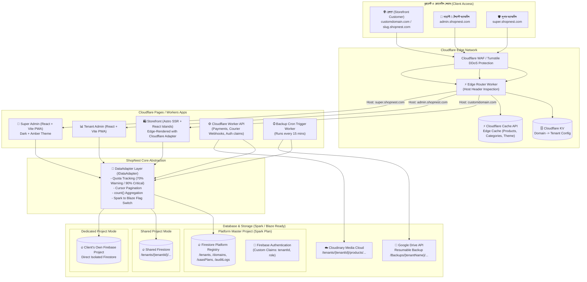
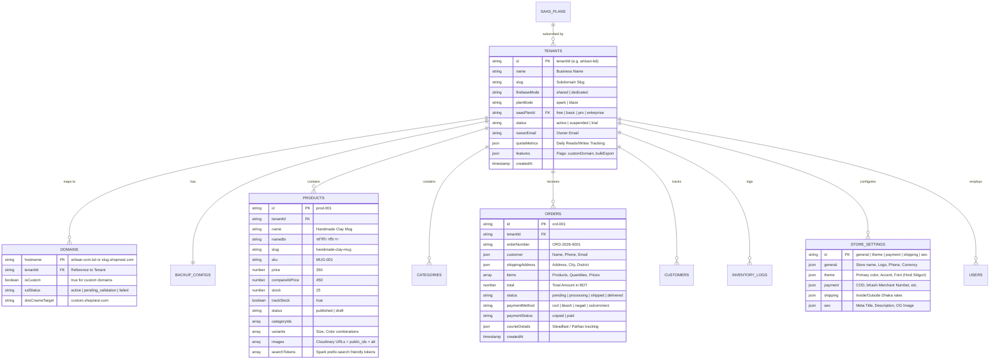

# ShopNest Multi-Tenant E-Commerce SaaS Architecture & Data Model

## ১. সম্পূর্ণ সিস্টেম আর্কিটেকচার (Complete Architecture Diagram)

---

## ২. Firestore ডাটা মডেল (Firestore Data Model)

---

## ৩. Spark প্ল্যান সুরক্ষা ও কোটা মনিটরিং কৌশল (Spark Quota Guard)

1. **Zero Firebase Cloud Functions**: সমস্ত সার্ভার লজিক (অর্ডার তৈরি, পেমেন্ট ভেরিফিকেশন, ওয়েবহুক, ব্যাকআপ ক্রন) Cloudflare Workers-এ নির্বাহ করা হয়।
2. **Edge Caching via Cloudflare Cache API & KV**:
   - ক্যাটাগরি, পণ্যের বিবরণ ও স্টোর সেটিংস Cloudflare Edge-এ ক্যাশ করা হয়।
   - প্রতিবার স্টোরফ্রন্ট ভিজিটে সরাসরি Firestore Read হয় না।
   - টেন্যান্ট অ্যাডমিন থেকে কোনো পণ্য বা সেটিং পরিবর্তন হলে `Cloudflare Purge API` দিয়ে নির্দিষ্ট ক্যাশ ইনভ্যালিডেট করা হয়।
3. **Cursor-Based Pagination**:
   - `offset` এর বদলে `startAfter` (cursor token) ব্যবহার করা হয়, যাতে Spark-এর অপ্রয়োজনীয় স্ক্যান রিড না হয়।
4. **Aggregation via Native `count()`**:
   - Firestore `count()` অ্যাগ্রিগেশন কুয়েরি ব্যবহার করা হয় যা প্রতি ১,০০০ ডকুমেন্টের জন্য মাত্র ১টি Read খরচ করে।
5. **Real-time Quota Alert System**:
   - `QuotaTracker` প্রতিটি অপারেশন রিয়েল-টাইমে পর্যবেক্ষণ করে।
   - দৈনন্দিন Firestore Read সীমা (৫০,০০০) এর ৭০% এ সতর্কতা এবং ৯০% এ ক্রিটিক্যাল অ্যালার্ট জারি করে এবং টেন্যান্টকে Blaze-এ আপগ্রেড করার পরামর্শ দেয়।
6. **Blaze Migration Flag**:
   - প্রতিটি টেন্যান্ট ডকুমেন্টে `planMode: 'spark' | 'blaze'` ফ্ল্যাগ থাকে।
   - Blaze চালু হলে ব্যাকআপ এবং এক্সটেনশন স্বয়ংক্রিয়ভাবে অ্যাক্টিভেট হয়, ব্যবসায়িক কোনো কোড পরিবর্তন করতে হয় না।

